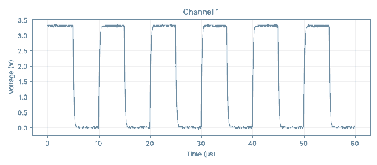

# Oscilloscope test report

- Date: 2026-11-18 11:25:47
- Source: simulator
- Instrument: SIM,SimulatedScope,0001,0.1
- Channel: 1
- Samples: 1200
- Result: **PASS**

## Measurements

| Measurement | Value | Unit |
|---|---|---|
| vpp_v | 3.44 | V |
| v_low_v | -0.04 | V |
| v_high_v | 3.32 | V |
| v_mean_v | 1.657 | V |
| v_rms_v | 2.311 | V |
| frequency_hz | 1e+05 | Hz |
| rise_time_s | 3.062e-07 | s |

## Limit checks

| Measurement | Value | Min | Max | Result |
|---|---|---|---|---|
| frequency_hz | 1e+05 | 9.9e+04 | 1.01e+05 | PASS |
| vpp_v | 3.44 | 3.2 | 3.8 | PASS |
| rise_time_s | 3.062e-07 | - | 5e-07 | PASS |

